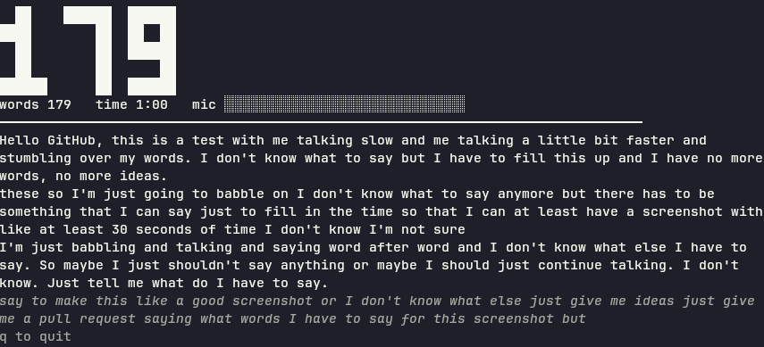

# wordcount

A local, offline Linux CLI that listens to a microphone and shows your live
words per minute plus a running transcript. Speech recognition runs on your
machine with [whisper.cpp](https://github.com/ggml-org/whisper.cpp); no audio
leaves it.



## Build

Prerequisites: `cmake`, `g++`, `make`, `git`, and Go. On Fedora:

```sh
sudo dnf install cmake gcc-c++ make git golang
make check-deps   # verifies the tools above are on PATH
make build        # fetches whisper.cpp (pinned tag), builds its static libs, builds ./wordcount
./wordcount --version
```

`make test` runs `go vet` and the unit tests (with the cgo flags set up). The
whisper tests use `models/ggml-base.bin` and skip if it is missing.

`make build` clones whisper.cpp into `third_party/` and builds into `build/`
on first use; later builds only recompile the Go code. `make clean` removes
`build/` and the binary.

whisper.cpp is built with `-march=native`, so the binary is tuned for the CPU
it was built on. Rebuild on the target machine rather than copying it between
different CPU generations.

### GPU build (Vulkan, optional)

The default build is CPU-only and needs nothing beyond the tools above. To run
the model on a GPU, install the Vulkan development packages and build with
`GPU=vulkan`. On Fedora:

```sh
sudo dnf install vulkan-headers vulkan-loader-devel glslc spirv-headers-devel
make build GPU=vulkan
./wordcount --version
```

The GPU build uses its own directory (`build/whisper-vulkan`), so switching
between `make build` and `make build GPU=vulkan` does not recompile whisper.cpp.
If a GPU prerequisite is missing, the build stops before compiling and names
it; an existing `./wordcount` is left untouched.

## Model

The speech model is not bundled. Download a multilingual whisper model and
pass its path with `--model`:

```sh
mkdir -p models
curl -L -o models/ggml-base.bin \
  https://huggingface.co/ggerganov/whisper.cpp/resolve/main/ggml-base.bin
```

`base` or `small` are recommended for live use on a laptop CPU.

## Usage

```sh
./wordcount --model models/ggml-base.bin            # pick a microphone interactively
./wordcount --model models/ggml-base.bin --device 2 # device by index, or by unique name substring
./wordcount --list-devices                          # print "<index>: <name>" and exit
./wordcount --model models/ggml-base.bin --lang nl  # force a language (default: auto)
./wordcount --model models/ggml-base.bin --file speech.wav # play and analyse a WAV or MP3 file
./wordcount --model models/ggml-base.bin --no-gpu   # force the CPU (GPU builds only)
./wordcount --model models/ggml-base.bin --gpu-device 1 # run on the GPU with index 1
./wordcount --version                               # backends, GPUs with their indices, CPU features
```

Quit with `q`, Esc or Ctrl+C. A one-line summary (total words, duration,
average WPM) is printed on exit.

`--list-devices` also shows PulseAudio/PipeWire "Monitor of ..." entries. Those
capture what the speakers are playing, not a microphone.

The binary links whisper.cpp statically but depends on the usual system runtime
libraries (glibc, libstdc++, libgcc_s, libgomp); audio backends are loaded at
runtime.

### GPU use

A binary built with `make build GPU=vulkan` (see Build) runs the model on a GPU
by default and falls back to the CPU, with a warning, when no usable GPU is
found or the model does not fit. A line `compute backend: ...` is printed
before the screen opens, so a CPU fallback is never silent. A CPU-only binary
prints `compute backend: CPU`.

- `--no-gpu` forces the CPU. On a CPU-only build it changes nothing.
- `--gpu-device <index>` picks the GPU. The indices are the ones `--version`
  lists; on a CPU-only build, with an unknown index or together with `--no-gpu`
  it exits with an error before the model loads.

With several GPUs the default is index 0, which is not always the fastest. On a
laptop the integrated GPU often comes first: check `--version` and pass
`--gpu-device` for the discrete card.

### GPU performance

Measured with whisper.cpp's `whisper-bench` (8 threads, flash attention on, the
same default as wordcount) on a laptop with an Intel Arc integrated GPU (index
0) and an NVIDIA RTX 500 Ada with 4 GB of VRAM (index 1). These numbers are an
example from one machine, not a promise.

Encode time for one 30 s window (ms, lower is better):

| model  | CPU  | Arc (0) | NVIDIA (1) |
|--------|------|---------|------------|
| base   |  449 |     196 |         11 |
| small  | 1772 |     801 |         47 |
| medium | 7873 |    2177 |        138 |

Decode time per token (ms):

| model  | CPU   | Arc (0) | NVIDIA (1) |
|--------|-------|---------|------------|
| base   |  3.4  |    4.9  |        1.9 |
| small  | 18.0  |    9.9  |        5.0 |
| medium | 31.4  |   22.4  |       13.7 |

What this means:

- The encoder is where the GPU wins: about 40x faster than the CPU for `base` and
  `small` on the NVIDIA card. The decoder gains much less (1.7-3.6x on the NVIDIA
  card), and on the integrated GPU `base` decodes slower than on the CPU.
- `--gpu-device` matters. The default is index 0, here the integrated Arc, which
  is 2-4x faster than the CPU at encoding but 16-18x slower than the NVIDIA
  card. Use `--version` to see which index is which and pass
  `--gpu-device 1` for the discrete card. Indices are wordcount's own (GPUs in
  whisper.cpp's order) and need not match other Vulkan tools.
- `medium` needs 7.9 s to encode a window on the CPU, so it cannot keep up with
  live speech there. On the NVIDIA card it encodes in 0.14 s.
- 4 GB of VRAM is enough for `medium` and the quantized `large-v3-q5_0`: both
  peaked at about 2.2 GB in use (`nvidia-smi`) while analysing a 55 s file, and
  live partials kept up. The unquantized `large-v3` (about 3 GB of weights) was
  not tried; it is unlikely to leave room on a 4 GB card.
- Word counts on the same files were identical on CPU and GPU with `base`
  (22 and 119 words for an 11 s and a 55 s file).

To reproduce the timings, build `whisper-bench` from `third_party/whisper.cpp`
with `-DWHISPER_BUILD_EXAMPLES=ON` (and `-DGGML_VULKAN=1`) in a separate build
directory and run `whisper-bench -m models/ggml-base.bin -t 8`, adding `-ng`
for the CPU or setting `GGML_VK_VISIBLE_DEVICES=0` or `1` to choose a GPU.

### Analysing a file

`--file` plays a WAV or MP3 file through the default output device and shows
the same live word count, WPM and transcript while it plays, in step with what
you hear. No microphone is needed and the device picker is skipped. The format
is recognised from the file content, not its extension. WAV must be 8, 16, 24
or 32-bit PCM (not float or compressed); MP3 any sample rate or channel count.
The whole file is decoded into memory, so files over one hour are rejected.
`--file` cannot be combined with `--device`.

When the file ends, the last utterance is counted, the display freezes with a
"finished" footer, and the program waits for you to quit. The exit summary
covers the whole file (total words, its duration, average WPM). Quitting
earlier summarises the part that was played. A file that cannot be read,
decoded or has no audio, or a machine without an output device, is reported
before the screen opens.

## Accuracy check

Method: `espeak-ng -s 150` read a fixed 203-word text, which came out as 79.6 s
of audio, a true rate of 153 WPM. It was played with `paplay` while
`./wordcount --model models/ggml-base.bin --device <Monitor of ...>` listened to
the monitor of the output device (base model, English text, 2026-10-21).

| Playback time | Displayed WPM | Words counted |
|---------------|---------------|---------------|
| 30 s          | 138           | 70            |
| 45 s          | 145           | 110           |
| 60 s (window full) | 171      | 171           |
| 70 s          | 174           | 191           |
| 80 s          | 168           | 214           |
| end (87 s)    | 156           | 219           |

Once the 60 s window was full the display read 165-174 WPM against a true 153,
i.e. 8-14% high, inside the 15% target but close to its edge. The total came
to 219 words against 203 spoken (+8%). Continuous synthetic speech has few
pauses, so utterances are split at the 15 s cap, possibly mid-word; that is a
likely but unconfirmed cause of the over-count. Natural speech with pauses was
not measured.

### Accuracy check with `--file`

The same check without a monitor device: `espeak-ng -s 150 -w text.wav` read a
fixed 255-word text (five paragraphs, with sentence pauses) as a 90.2 s,
22.05 kHz WAV, a true rate of 170 WPM. `./wordcount --model models/ggml-base.bin
--file text.wav` (base model, English, 2026-10-22) counted 258 words
(+1.2%) and its exit summary read "258 words in 1:30, average 172 WPM" (+1.4%),
well inside the 15% target. Displayed totals during playback were 28 words at
10 s, 87 at 30 s, 161 at 60 s and 223 at 80 s.
